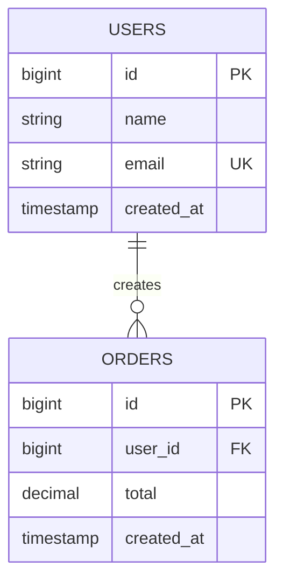

# Phase 1 — Product & Technical Documentation

## Objective

Convert the approved discovery results into structured project documentation. All documentation must reflect the exact same requirements and architecture.

Target baseline structure:

```text
project-root/
├── docs/
│   ├── PRD.md
│   ├── ERD.md
│   ├── TECH_SPEC.md
│   ├── TASKS.md
│   └── adr/
│       └── README.md
└── README.md
```

---

## Step 1.1 — Create `docs/PRD.md`

The Product Requirements Document defines what the application must accomplish and why.

Required sections:
1. Document Information
2. Executive Summary
3. Background & Problem Statement
4. Product Vision
5. Goals & Objectives
6. Target Users
7. User Personas (when useful)
8. User Roles & Permissions
9. Business Processes & Formulas (if applicable)
10. Functional Requirements (`FR-001`, `FR-002`, ...)
11. Non-Functional Requirements (`NFR-001`, ...)
12. User Stories (`US-001`, ...)
13. Acceptance Criteria (`AC-001`, ... — testable, unambiguous, Given/When/Then where appropriate)
14. MVP Scope
15. Out of Scope
16. Development Waves
17. Dependencies
18. Risks & Constraints
19. Success Metrics

---

## Step 1.2 — Create `docs/ERD.md`

The Entity Relationship Document defines the application's data architecture.

Required sections:
1. Database Overview
2. Database Design Principles
3. Entity Relationship Diagram (Mermaid `erDiagram`)
4. Table Specifications
5. Data Dictionary
6. Relationship Explanation
7. Indexing Strategy
8. Constraints
9. Data Integrity Rules
10. Security Considerations

### Mermaid ERD Example



### Data Dictionary Format

For every table, document:

| Column | Type | Nullable | Key | Description |
|---|---|---|---|---|
| `id` | BIGINT UNSIGNED | No | PK | Primary identifier |
| `user_id` | BIGINT UNSIGNED | No | FK | Related user (`users.id`) |
| `created_at` | TIMESTAMP | Yes | - | Creation timestamp |

Also document:
- Unique constraints
- Foreign key behavior (`CASCADE`, `RESTRICT`, `SET NULL`)
- Soft deletes (if any)
- Enumerations
- JSON fields
- Sensitive data handling
- Indexes

> Do not invent tables without functional requirements supporting them. Validate the ERD against PRD user stories and business rules.

---

## Step 1.3 — Create `docs/TECH_SPEC.md` & ADRs

The Technical Specification defines how the application will be implemented.

Required sections:
1. Technical Overview
2. Approved Technology Stack
3. System Architecture (include Mermaid diagram when helpful)
4. Application Structure
5. Backend Architecture
6. Frontend Architecture
7. API Design & External API Contracts (if applicable)
8. Authentication & Authorization
9. Database Strategy
10. Validation Strategy
11. Error Handling
12. Logging & Monitoring
13. Queue & Background Processing
14. File Storage
15. Security Architecture
16. Testing Strategy
17. Deployment Architecture
18. Environment Configuration
19. Technical Constraints

Use explicit decisions instead of vague recommendations. For major architectural decisions, create ADR documents in `docs/adr/`:

```text
docs/adr/
├── README.md
├── 0001-database-selection.md
├── 0002-authentication-strategy.md
└── 0003-application-architecture.md
```

Each ADR includes: **Context**, **Decision**, **Alternatives**, **Consequences**, and **Status**.

---

## Step 1.4 — Create `docs/TASKS.md`

`TASKS.md` is the single source of truth for project implementation progress, organized by **Wave**, **Phase**, **Module**, and **Priority**.

### Task Board Format

```markdown
# Project Task Board

## Progress Overview
- **Status Progress**: 0 / N Completed (0%)
- Total Tasks: N
- Completed: 0
- In Progress: 0
- Blocked: 0
- Pending: N

## Wave 1 — MVP

### Module: Authentication

| Status | ID | Task | Priority | Dependencies | Acceptance Criteria | Completed Date |
| :-: | --- | --- | --- | --- | --- | :-: |
| [ ] | `W1-001` | Initialize project | High | - | Project boots cleanly | - |
| [ ] | `W1-002` | Configure database | High | `W1-001` | DB connection verified | - |
```

Task Status markers:
- `[ ]` Pending
- `[~]` In Progress
- `[x]` Completed
- `[!]` Blocked

Rules:
- Recalculate progress counters whenever task statuses change.
- Break large tasks into smaller, independently verifiable units.
- Every functional requirement in `PRD.md` must map to one or more implementation tasks.

---

## Step 1.5 — Documentation Consistency Review

Before requesting approval, validate:
- PRD requirements match ERD entities.
- ERD supports all business processes.
- TECH_SPEC matches the approved technology stack.
- TASKS covers all approved MVP requirements and security tasks.
- Dependencies are valid and acyclic.
- No unapproved features have entered the scope.

### Completion Criteria
- [ ] `docs/PRD.md` created and reviewed.
- [ ] `docs/ERD.md` created with validated Mermaid diagram and Data Dictionary.
- [ ] `docs/TECH_SPEC.md` and `docs/adr/` created and reviewed.
- [ ] `docs/TASKS.md` created.
- [ ] Cross-document consistency verified.
- [ ] User approval received.

**Gate:** Do **NOT** proceed to Phase 2 until the user approves the documentation.
